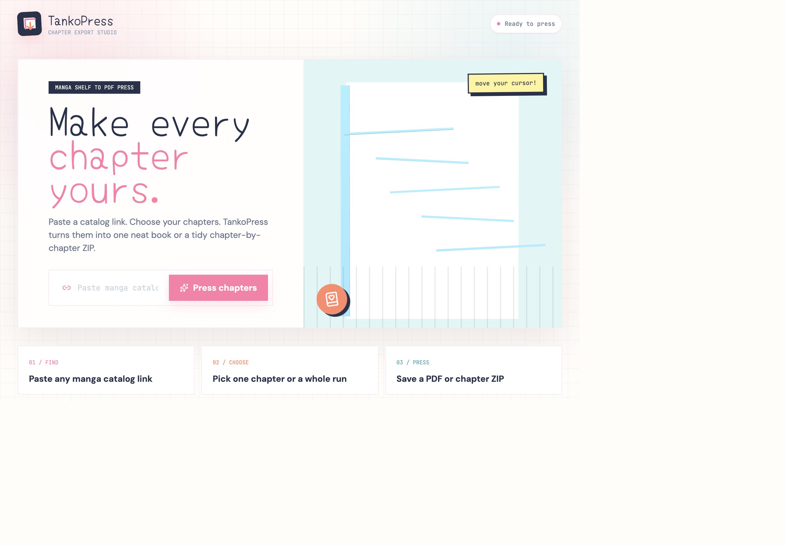
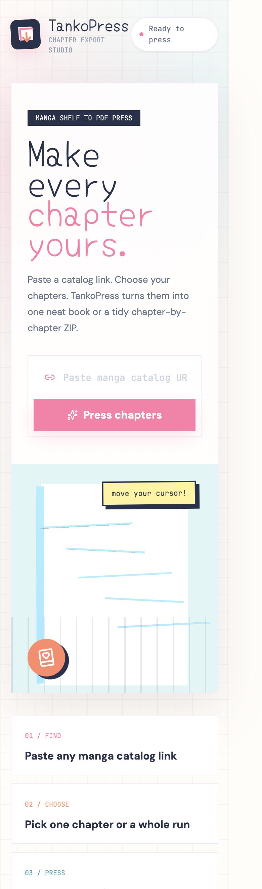

# TankoPress

TankoPress is a FastAPI and Playwright application for turning manga catalogs into downloadable PDF exports. Paste a catalog URL, choose chapters, preview the range, and export either one merged PDF or a ZIP containing one PDF per chapter.

## Screenshots

### Desktop



### Mobile



## Features

- Responsive manga-export homepage
- Branded loading screen and interactive homepage artwork
- Manga catalog analysis through Playwright
- Chapter search, range selection, select all, invert, and clear actions
- One merged PDF export
- Chapter-by-chapter ZIP export
- Background export jobs with live progress and terminal output
- Automatic manga and chapter naming
- Original, high, and compact image quality modes

## Tech Stack

- Python and FastAPI
- Playwright for rendered catalog scraping
- httpx for image downloads
- Pillow, img2pdf, and pypdf for PDF processing
- Jinja2 templates
- Alpine.js and Tailwind CSS
- Three.js for the homepage scene

## Requirements

- Python 3.11 or newer
- pip
- Playwright Chromium
- macOS, Linux, or Windows

## Local Setup

```bash
git clone <your-github-repository-url>
cd <repository-directory>

python3 -m venv .venv
source .venv/bin/activate
python -m pip install -r requirements.txt
python -m playwright install chromium

uvicorn main:app --reload --host 127.0.0.1 --port 8000
```

Windows PowerShell activation:

```powershell
.venv\Scripts\Activate.ps1
```

Open [http://127.0.0.1:8000](http://127.0.0.1:8000).

## Production

Run the application with a production server or process manager:

```bash
uvicorn main:app --host 0.0.0.0 --port 8000
```

The server must have Playwright Chromium installed. For deployment instructions, see [DEPLOYMENT.md](DEPLOYMENT.md).

## Tests

```bash
python -m pytest
```

## Output Naming

Merged PDF exports use the manga title and selected range:

```text
Manga Name 1-169.pdf
```

ZIP exports use the manga title for the archive and folder, with chapter-number PDFs inside:

```text
Manga Name.zip
└── Manga Name/
    ├── Chapter 1.pdf
    ├── Chapter 2.pdf
    └── Chapter 3.pdf
```

## Hosting

TankoPress needs a backend. A static host alone cannot run FastAPI, Playwright, scraping, image downloads, PDF generation, or background export jobs.

Deploy the full Python application to a VPS, Railway, Render, or another service that supports long-running Python processes. See [DEPLOYMENT.md](DEPLOYMENT.md).

## Legal and Responsible Use

Use TankoPress only with content you are permitted to access and download. Respect source websites' terms, copyright, robots rules, and rate limits. The decorative catalog titles are fictional and used only for homepage aesthetics.
